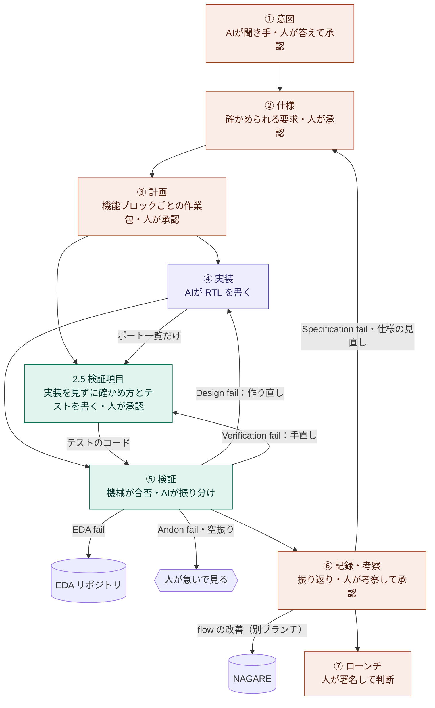

# NAGARE — AIに開発を任せるためのワークフロー

AIに開発を依頼するとき、「何を・どの段で・どの書式で」渡すかを決めておき、
**出戻りと token を減らしながら**開発を進めるための流れ（flow）。半導体設計を土台にし、ほかの業界の知見を取り込んでいる。

- 状態：①〜⑦と 2.5 の書式・8つのエージェント・読める範囲を守る仕組みまで完成。Kekkai の `tk_lib_sfifo` で試運転中
- 最初の検討：2026-11-14

## 流れ（全体図）



色の意味：**オレンジ＝人が決める段**／**紫＝AIが作る段**／**緑＝確かめる段**（実装とは別のエージェントが担う）

## 各段の要点

| 段 | 何をする段か | ここだけは押さえる（要点） | 人の出番 | 書式・エージェント |
|---|---|---|---|---|
| ① 意図 | 依頼文から「何のために・何を」を固める | 目的・最終状態・物差し（数字）・やらないことを空けない。AIは空欄だけを1回3問まで聞く | 質問に答える、承認する | [意図メモ](docs/03_書式/01_意図メモ.md)／`nagare-intent` |
| ② 仕様 | 意図を、確かめられる要求の一覧にする | 要求は1文1件。あいまい語は禁止。①のすべての欄に要求がつながる。確かめ方は書かない（2.5 の仕事） | 判断の選択肢を選ぶ、承認する | [仕様書](docs/03_書式/02_仕様書.md)／`nagare-spec` |
| ③ 計画 | 仕様を、機能ブロックごとの作業包に分ける | つながり（ポート・バス）を先に作る。余裕は最長ルートの最後にまとめる。同時に進めるのは4個まで。前提ごとに必須か任意かを決める。失敗とアラートの条件を先に決める | 承認する | [計画書](docs/03_書式/03_計画書.md)／`nagare-plan` |
| 2.5 検証項目 | 実装を見ずに「何をどう確かめるか」を決め、テストのコードも書く | 出どころは3つ（世の中の作法・仕様の要求・プロジェクト特有）。検証（仕様どおりか）と妥当性確認（意図どおりか）を分ける。RTL の中身は読まず、ポート一覧だけを見る | 承認する、検査点（停止・立会・書類）を決める | [検証項目](docs/03_書式/2.5_検証項目.md)／`nagare-vplan` |
| ④ 実装 | 作業包ごとに RTL と設計者のアサーションを書く | 着手前に復唱する。3つの区切りで点検する。異常が出たら回避せずに止める。テストは書かない。計画との違いを記録し、4欄（状況・背景・評価・提案）で報告する | 止まった項目に答える | [実装報告](docs/03_書式/04_実装報告.md)／`nagare-impl` |
| ⑤ 検証 | テストを流して合否を出し、不合格を振り分ける | 判定は6つの状態で行い、空振りはまず Andon fail に入れる。原因の候補を2つ以上並べてから決める。分類は5つ（Design・Verification・Specification・EDA・Andon）。特採は人が決める | 特採・修理・廃棄、停止点の解除を決める | [検証報告](docs/03_書式/05_検証報告.md)／`nagare-verify` |
| ⑥ 記録・考察 | 振り返り、学びを書式・規約・NAGARE に戻す | 4つの問い（起きるはずだったこと・実際・なぜ・次に）で、責めずに書く。物差しとしきい値（弊害20個／週、夜のやり直し4回／週、2.5 の開始待ち5日）を見る。flow の改善は NAGARE の別ブランチに出す | 考察する、承認する | [記録・考察](docs/03_書式/06_記録・考察.md)／`nagare-review` |
| ⑦ ローンチ | 外に出すかを決める | 各段が「出してよいか」を表明する。中止の条件と戻れない点を先に書く。段階的に出して戻し方を用意する。判断は人の鍵で署名したタグ | 署名して判断する | [ローンチ判定](docs/03_書式/07_ローンチ判定.md)／`nagare-launch` |

## 全段に共通する決まり

- **前の段の書式だけを読む**：会話の履歴をさかのぼらないので、読む量（token）と出戻りが減る
- **終わりは機械で判定する**：各書式の「出口の条件」で、終わったかどうかを決める
- **承認の印は人だけが書く**：AIが `status: approved` を書こうとすると止まる。⑦の判断は人の署名タグ
- **読める範囲は仕組みで守る**：エージェントごとに読める・書ける場所が決まっていて、hook が止める。①②⑦と 2.5 が設計物を読むには、人の許可が要る
- **夜は項目ごとに進める**：止めるのは問題のあった項目だけ。条件を満たすほかの項目は進める
- **各段は `claude --agent nagare-<段>` で起動する**：途中で人に質問でき、前の段の会話の記憶は持ち込まない

## 使い方

```bash
python3 scripts/install.py <プロジェクト> --design rtl   # 書式・エージェント・hook を入れる
cd <プロジェクト>
claude --agent nagare-intent                              # ①から始める
```

詳しい手順は [docs/08_試運転の手順.md](docs/08_試運転の手順.md)。

## 目次

| ファイル | 中身 |
|---|---|
| [docs/01_決定事項.md](docs/01_決定事項.md) | 決定 D1〜D24 と、その理由・崩れる条件 |
| [docs/02_フロー構成.md](docs/02_フロー構成.md) | 段の構成、戻り方、エージェントごとの読める範囲 |
| [docs/03_書式/](docs/03_書式/) | 8つの書式（①〜⑦と 2.5） |
| [docs/04_お手本調査.md](docs/04_お手本調査.md) | 各段のお手本（他業界を含む）と出典 |
| [docs/05_未決の論点.md](docs/05_未決の論点.md) | まだ決まっていない論点 |
| [docs/06_思考トレーニング記録.md](docs/06_思考トレーニング記録.md) | 検討中の思考の型の採点と指摘 |
| [docs/07_エージェント定義.md](docs/07_エージェント定義.md) | 8つのエージェント、読める範囲を守る hook、承認の仕方 |
| [docs/08_試運転の手順.md](docs/08_試運転の手順.md) | 一度回すための手順（入れ方・起動・記録） |
| `templates/` | プロジェクトに入れるエージェント・hook・設定の原本 |
| `scripts/install.py` | プロジェクトに入れるための小さなプログラム |
| `tests/` | hook と署名の確認のテスト |

## 次にやること

1. Kekkai の `tk_lib_sfifo` で一度回す（試運転中）
2. 回した記録から、物差しの今の値と、保留にした論点（差分の見せ方、副本を作る段、崩れる条件）を決める
3. EDA リポジトリ側：規約 v0.2 の取り込みと残り2点、壊れた RTL を流したときの各フローの動きの確認（P4）
