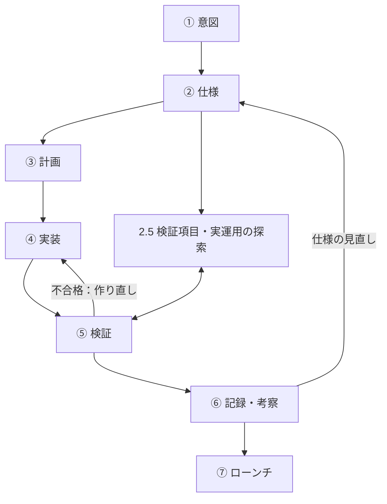

# フロー構成

← [README](../README.md)

## 1. 段の構成と戻り方（D2）

- 軽い戻り：⑤ → ④（作り直し）、⑤ ↔ 2.5（確かめ方の手直し）
- 重い戻り：⑥ → ②（作るはずだったものが変わる）。必ず⑥の考察を通す

## 2. 人の関わり方

すべての .md はAIが書く。人は次の3つだけを担う。

| 関わり方 | 段 | 中身 |
|---|---|---|
| 答える | ① | AIが質問し、人が答える。AIが書き取る |
| 承認する | ②・2.5・⑥ | AIの草案を読み、「進めてよい」と印を付ける（approved に変えるのは人だけ） |
| 判断する | ⑦ | 出すか出さないかを決める |

③④⑤は、AIと機械だけで回る（⑤の合否は機械が出す）。

## 3. 全段に共通する書式の骨組み（案）

| 部分 | 中身 |
|---|---|
| 見出し（YAML） | 書式ID、段、版、状態（draft／approved）、前の段の書式ID、承認者 |
| 本文 | 段ごとの欄 |
| 出口の条件 | 機械で確かめられる形の条件 |
| 申し送り | 決まったこと／次の段がやること |
| 変更の記録 | 日付・何を変えたか・誰が |

「入口の条件」（前の段が approved か）を共通の骨組みに足すかは未決（[05_未決の論点.md](05_未決の論点.md) の c）。①②の書式では出口の条件の中で確かめている。

## 4. エージェントごとに読めるもの（D5〜D8）

| エージェント | 意図 | 仕様 | 検証項目 | 計画 | 実装物 | 検証結果 | 記録 |
|---|---|---|---|---|---|---|---|
| ① 意図 | 読む | | | | 許可制 | | |
| ② 仕様 | 読む | 読む | | | 許可制 | | 読む |
| 2.5 検証項目 | 読む | 読む | 読む | | 許可制 | | |
| ③ 計画 | | 読む | | 読む | いつでも | | |
| ④ 実装 | | 読む | | 読む | いつでも | | |
| ⑤ 検証 | | | 読む | | いつでも | 読む | |
| ⑥ 記録・考察 | 読む | 読む | 読む | 読む | いつでも | 読む | 読む |
| ⑦ ローンチ | 読む | | | | 許可制 | 読む | 読む |

- 許可制：人がその都度判断する（D8）。許可がなければ読めないことを、エージェントごとの hook で守る
- 実現の仕組み：サブエージェントの定義（`.claude/agents/*.md`）の hooks 欄に、読む前に動く hook を付け、「読んでよい場所の一覧」の外は止める
- 2.5 は妥当性確認のため①も読む（D11）
- 表は検討時の案。flow を回しながら直す
