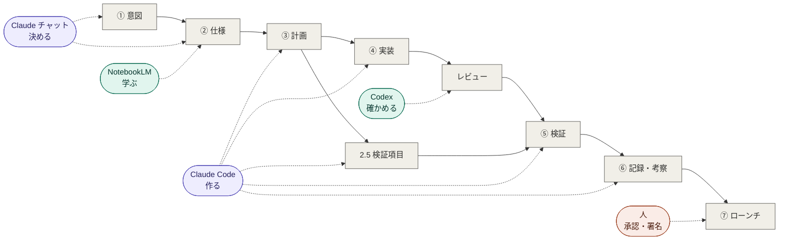
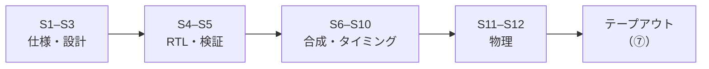

# AI ツールの使い分け（どの段で、どの AI を使うか）

**結論：** AI は「決める」「作る」「確かめる（レビュー）」「学ぶ」の4つの役に分け、役ごとに別のツールを使う。人が決める点（承認・関所）は変わらない。

- 状態の見方：**決定** は [01_決定事項.md](01_決定事項.md) に記録済み。**案** はまだ決めていない
- 最終更新：2026-11-24

## 1. 4つの役とツール

| 役 | ツール | 何をするか | 状態 |
|---|---|---|---|
| 決める | Claude（チャット） | 設計を相談して決める。理解の関所（D26）で説明し、言い直しの抜けを指摘する | 決定（D28） |
| 作る | Claude Code（`nagare-*` エージェント） | 書式・RTL・テスト・資料を書き、EDA を回し、結果を読み解く。④実装と 2.5 検証項目は別のエージェント（D13） | 決定（D28） |
| 確かめる | ChatGPT の Codex（Plus 月20ドル） | Claude Code が書いたコードを、別のモデルでレビューする | 決定（D27） |
| 学ぶ | NotebookLM | 公開されている資料（規格書など）と自分の資料を読ませて、質問・音声の解説・クイズで理解を確かめる | 決定（D28） |

**NotebookLM に入れないもの：** 講座の資料と理解ノート（D26）。関所で使う確認クイズは、PC の中の理解ノートを Claude が場所の参照で読む。

## 2. NAGARE の段と AI

| 段 | 主に使う AI | 人がすること |
|---|---|---|
| ① 意図 | Claude チャット | 質問に答える、承認する |
| ② 仕様 | Claude チャット（＋ NotebookLM で規格を読む） | 選択肢を選ぶ、承認する |
| ③ 計画 | Claude Code（`nagare-plan`） | 承認する |
| 2.5 検証項目 | Claude Code（`nagare-vplan`） | 承認する、検査点を決める |
| ④ 実装 | Claude Code（`nagare-impl`） | 止まった項目に答える |
| レビュー（④のあと） | Codex | 指摘を採るか決める |
| ⑤ 検証 | Claude Code（`nagare-verify`）＋ EDA | 特採・修理・廃棄を決める |
| ⑥ 記録・考察 | Claude Code（`nagare-review`） | 考察する、承認する |
| ⑦ ローンチ | （AI は判断しない） | 署名して判断する |

レビューを ⑤ の前に置くこと、また段として独立させるかは **案**（エージェントの定義と書式はまだ変えていない）。

## 3. 半導体の12工程と道具（案）

各工程の前に、理解の関所（D26）がある：AI が図で説明 → 人が言い直す → AI が抜けを指摘 → 人が決める。

✅＝EDA リポジトリに入っている、🆕＝新しく足す候補（案）

| 工程 | AI | EDA | 資料・図 |
|---|---|---|---|
| S1 設計仕様 | Claude チャット、NotebookLM | 🆕 PeakRDL（レジスタ表から RTL と表を作る） | Mermaid、`system.yaml` |
| S2 階層設計 | Claude チャット | ✅ cdc-check | Mermaid（ブロック図） |
| S3 論理回路 | Claude チャット | （レビュー） | Mermaid（状態遷移図） |
| S4 RTL | Claude Code（④）→ Codex（レビュー） | ✅ verilator-lint、Verible | — |
| S5 論理検証 | Claude Code（2.5） | ✅ cocotb-sim、sby-formal | WaveDrom（期待する波形）、GTKWave |
| S6 制約 SDC | Claude チャット＋ Claude Code → Codex | （レビュー） | WaveDrom（入出力の遅延） |
| S7 論理合成 | Claude Code | ✅ yosys-synth | Sphinx（result.json の表） |
| S8 等価・X | Claude Code | ✅ eqy-equiv | 同上 |
| S9 STA | Claude Code | ✅ sta-synth | 同上 |
| S10 テスト設計 | Claude Code | ✅ dft-scan | 同上 |
| S11 配置配線 | Claude Code | ✅ openroad-pnr、librelane-rtl2gds | KLayout |
| S12 BE の検証 | Claude Code | ✅ LibreLane の DRC・LVS | KLayout |

FPGA（DE0-CV）では S6〜S12 の EDA が Quartus に置き換わる。

## 4. 残っている論点

- D27：「足りない」とするトークン使用量の数字。コードを外に出すこと（学習に使われない設定）を崩れる条件に入れるか
- レビューの段の置き場所（⑤の前か、段として独立させるか）
- 3章の表の中身（PeakRDL を足すか など）を1つずつ決める
- D25：赤信号を出したときに何が起きるか
