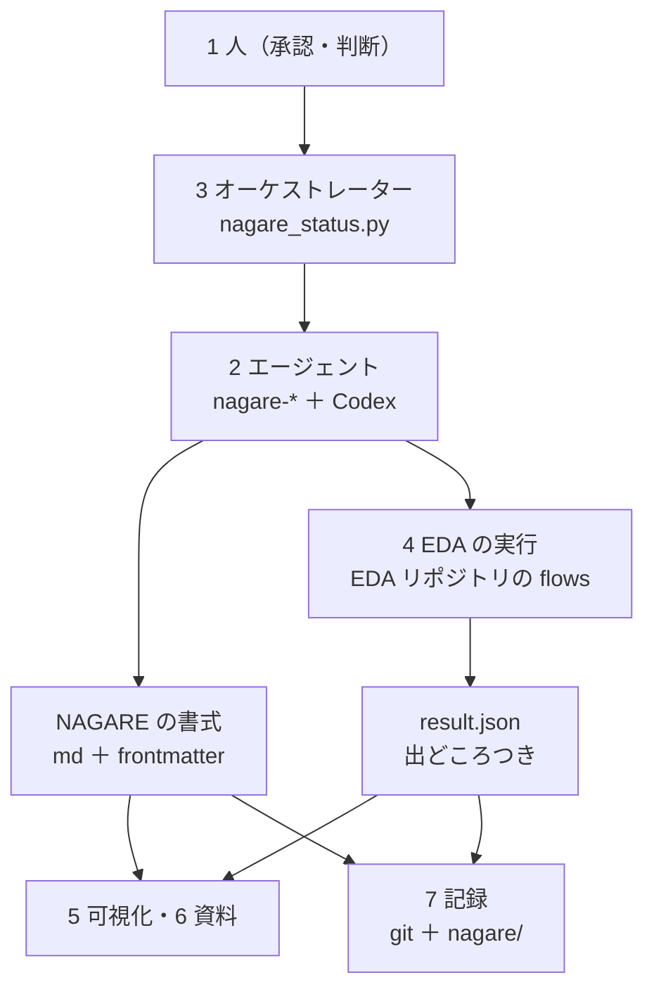

# 多エージェントの開発基盤：Phase 0 の設計（NAGARE 向けに直したもの）

← [README](../README.md)

- 状態：**案**（Phase 0。オーナーの承認を待つ。承認するまで Phase 1 の残りは作らない）
- 元の指示書：Hybrid Multi-Agent Semiconductor Development & Visualization Framework（2026-11-26 に受け取ったもの）
- 関係する決定：D25（方法と道具を分ける）、D27〜D30
- 最終更新：2026-11-26

## 0. 結論

**指示書の骨組み（オーケストレーター・並列・独立レビュー・パイプライン）は、新しく作らずに NAGARE の段・書式・hook の上に載せる。** 指示書の4つの層を、NAGARE ですでにある部品に対応させる。足りないのは次の3つだけで、そこから作る。

1. 段を自動で見張るオーケストレーター
2. 別のモデルによるレビュー（D29）
3. EDA の結果の出どころの記録

EDA と可視化の道具は、D25 どおり EDA リポジトリ側に置き、NAGARE からは約束（`result.json`）で読む。

## 1. 指示書から直した点

| 指示書 | NAGARE での形 | 直した理由 |
|---|---|---|
| 新しいリポジトリ `hybrid-agent-framework` | NAGARE を広げる | D30 |
| 9つの専門エージェント | 今ある8つ（`nagare-intent` 〜 `nagare-launch`）＋ Codex。Research・Documentation・Physical Design のエージェントは、必要になった段で足す（案） | 同じ役を二重に作らない。④と 2.5 を分ける D13 はそのまま |
| エージェント間のメッセージの決まり | NAGARE の書式（md ＋ frontmatter の `id`・`prev`・`status`）をそのままメッセージとして使う | D3・D4。すでに機械で読める |
| オーケストレーターがエージェントを起動する | **Phase 1 は見張るだけ**（次に進める段・止まっている段・上限を表示する）。起動は人が `claude --agent` で行う | 人が最後に決める（D23）。自動の起動は、見張りが正しく動いてから論点にする |
| Python の簡単なステートマシン → 必要なら LangGraph | 標準ライブラリだけの状態の見張り（`nagare_status.py`）。LangGraph は論点として残す | 指示書どおり、まず簡単なもの |
| Independent Reviewer の承認なしに次へ進まない | ④のあとに「レビュー記録（CRV）」を置き、Codex の判定（PASS／PASS_WITH_WARNINGS／NEEDS_REVISION／BLOCKED）と、人の振り分け（採る／採らない／仕様に戻す）を残す | D29。レビューの承認はテストの合格の代わりにしない（⑤はそのまま） |
| EDA の Adapter を `integrations/eda/` に作る | EDA リポジトリの `flows/` と `result.json` がそれにあたる。NAGARE には作らない | D25 |
| 可視化するデータに出どころの情報を付ける | 出どころの欄（ツール名・版・git のコミット・実行日時・入力・設定・状態）を `result.json` に足す。**EDA リポジトリの仕様（7章）を先に直す必要がある** | EDA の CLAUDE.md：形式を変えるときは先に仕様書を更新する |
| AI が作った図と、EDA の結果からの図を分ける | すべての図と表に「AI が作成」か「EDA の実行結果（result.json の場所）」のどちらかを書く | 指示書の要求どおり。実行していない検証を PASS と書かない |
| Docusaurus を資料の入口の第1候補にする | 論点として残す（前の指示書では Sphinx を基本にしていた） | 資料の道具を重複して入れない |
| Web の画面（Dashboard など） | Phase 5 まで作らない。それまでは GitHub と `nagare_status.py` の表示で見る | 指示書でも後の段 |

## 2. 道具の調べ（Phase 0 の要求の表）

ライセンスと版は、導入する前に各道具の公式の場所で確かめ直す。EDA の版は EDA リポジトリの `setup/versions.yaml` で固定しているもの。

| 道具 | 目的 | 入力 | 出力 | AI との連携 | ライセンス | 費用 | 導入 | 制約 |
|---|---|---|---|---|---|---|---|---|
| Claude Code | 書く・作る（D28） | 書式・指示 | 書式・コード | `claude --agent`、hook | 商用 | Claude のプラン | 導入済み | 使用量の上限 |
| Codex CLI | レビュー（D27） | 差分・AGENTS.md | 指摘 | `codex exec`（既定は読むだけの砂場） | Apache-2.0（CLI） | Plus 月20ドル | **未導入** | private のコードが OpenAI に渡る。Git の中で動かす |
| Mermaid | 流れ・状態・順序の図 | 文字 | 図 | AI が文字で書く。GitHub がそのまま描く | MIT | 0 | 不要 | 大きな構成図は崩れやすい |
| D2 | 構成図 | 文字 | SVG | AI が文字で書く | MPL-2.0 | 0 | 要 | 描画に D2 の実行ファイルが要る |
| PlantUML | UML | 文字 | 図 | AI が文字で書く | GPL など複数 | 0 | 要 | 初期の設定では図の中身を外部のサーバーに送る。private の設計には手元で描く設定が要る |
| Graphviz | 依存・階層のグラフ | DOT | 図 | Yosys の `show` などが DOT を出す | EPL | 0 | 要 | 大きなネットリストは読めない |
| WaveDrom | 期待する波形 | JSON | 図 | AI が JSON で書く | MIT | 0 | 要 | 実際の波形ではない |
| GTKWave | 実際の波形 | VCD・FST | 画面 | AI は読まない（波形の要約は cocotb の結果から） | GPL-2.0 | 0 | 要 | 画面で見るだけ |
| Yosys 0.62 | 合成 | RTL | ネットリスト・数字 | `flows/yosys-synth` | ISC | 0 | eda01 | ASIC は対応するライブラリが要る |
| Verilator 5.044 | Lint・シミュレーション | RTL | 警告・波形 | `flows/verilator-lint`・`verilator-sim` | LGPL-3.0／Artistic-2.0 | 0 | eda01 | 4値（X）は扱わない |
| cocotb | テスト | RTL・Python | 合否 | `flows/cocotb-sim` | BSD-3 | 0 | eda01 | — |
| SymbiYosys 0.62 | 形式検証 | RTL・性質 | 証明・反例 | `flows/sby-formal` | ISC | 0 | eda01 | 深さに限りがある |
| OpenSTA（OpenROAD 内） | STA | ネットリスト・SDC・ライブラリ | 経路と余裕 | `flows/sta-synth` | GPL-3.0 | 0 | eda01 | ライブラリと制約しだい |
| OpenROAD 2026-02-17 | 配置配線 | ネットリスト・PDK | レイアウト | `flows/openroad-pnr`・`librelane-rtl2gds` | BSD-3 | 0 | eda01 | 対応する PDK（sky130 など）だけ |
| Docusaurus／MkDocs／Sphinx | 資料サイト | md | Web | AI が md を書く | MIT／BSD-2／BSD-2 | 0 | 要 | 1つに絞る（論点） |
| React Flow／Cytoscape.js | 動く図 | JSON | Web | AI が JSON を書く | MIT／MIT | 0 | Phase 5 | Web の画面が要る |
| LangGraph | 段をつなぐ（将来） | — | — | Python | MIT | 0 | 論点 | 学ぶ手間が要る |

商用の EDA（Synopsys ICC2 など）とは、今はつながない。オープンソースでできる範囲は、上の表の「制約」の欄で分ける。

## 3. 進め方（NAGARE に合わせた段階）

| 段階 | 作るもの | 出口の条件 |
|---|---|---|
| Phase 0 | この設計書 | オーナーが承認する |
| Phase 1a（このブランチ） | レビュー記録の書式、Codex レビューの hook（D29）、見張りのオーケストレーター | テストがすべて合格。偽の Codex で、IMPL の `status: done` からレビュー記録ができる |
| Phase 1b | Codex CLI を入れて、Kekkai の tk_lib_sfifo で1回回す | 本物の Codex でレビュー記録が1件できる。D29 の崩れる条件1（実装1週間）を判定する |
| Phase 2 | 並列（git worktree で作業包ごとに作業場所を分ける） | 同時4個の作業包が、同じファイルを触らずに進む |
| Phase 3 | `result.json` の出どころの欄（EDA リポジトリの仕様を先に直す） | 全フローの result.json に出どころが付く |
| Phase 4 | 資料サイト（道具は論点で決める） | 書式と result.json が1つのサイトで読める |
| Phase 5 | Web の画面 | 論点で決める |
| Phase 6 | 群れ（Swarm）の準備 | 論点で決める |

## 4. リスク

| リスク | 物差し | 手当て |
|---|---|---|
| NAGARE が重くなり、方法のまとめでなくなる（論点 i） | NAGARE の中のプログラムの行数、`docs/` と `templates/` の比 | 動くものは `templates/` の下だけに置く |
| Codex の費用が足りない | D27：トークンの使用量 | 足りなければ B（サーバーを借りる）を見積もる |
| Codex が RTL を見られない | D29：採る指摘が10件中2件未満 | 考え直す |
| hook が長く止まる | レビュー1回の時間 | hook の時間切れを 900 秒にする。超えたら記録に BLOCKED と書く |
| 実行していない検証を PASS と書く | — | 状態は result.json からだけ取る。AI が数字を書き写さない |

## 5. 費用の見積もり

| 項目 | 費用 | 出どころ |
|---|---|---|
| Codex（Plus） | 月20ドル | D27 |
| Claude | 今のプランのまま（増やすかは使用量で判断） | — |
| 道具（表のオープンソース） | 0 | — |
| eda01 | 今の機材のまま | — |

## 6. 残っている論点（1つずつ決める）

1. 自動の起動：オーケストレーターがエージェントを起動するか（今は人が起動）
2. LangGraph をいつ入れるか
3. 資料サイトの道具（Docusaurus／MkDocs／Sphinx）
4. `result.json` に出どころの欄を足す（EDA リポジトリの仕様の変更）
5. 増やすエージェント（Research・Documentation・Physical Design）
6. 論点 i：NAGARE を広げることと D25 の両立
